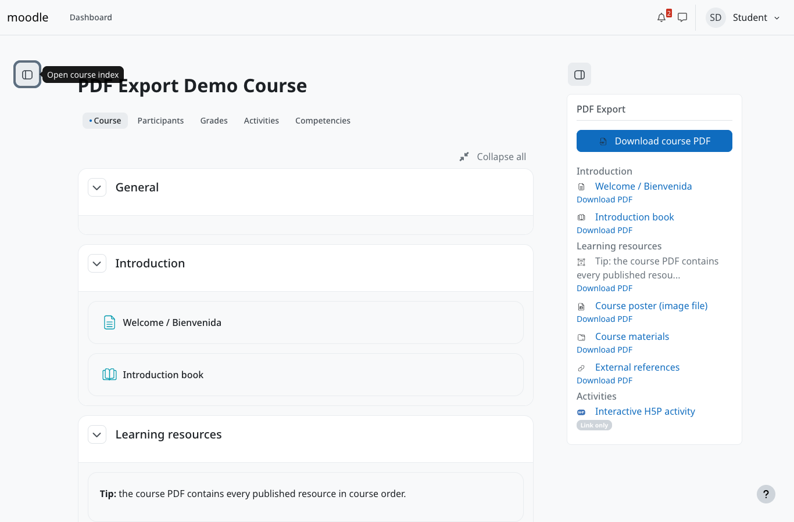
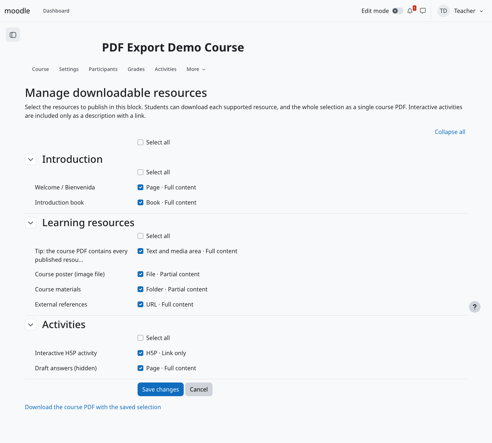
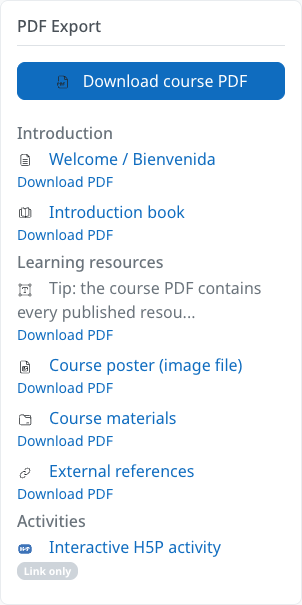
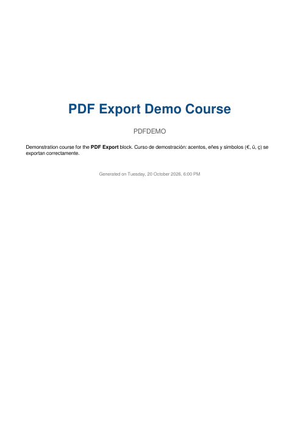
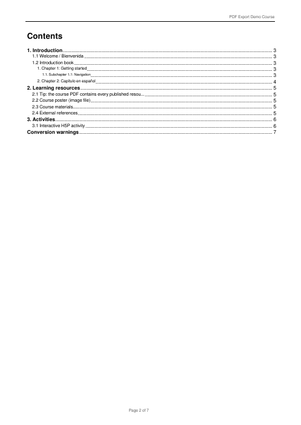
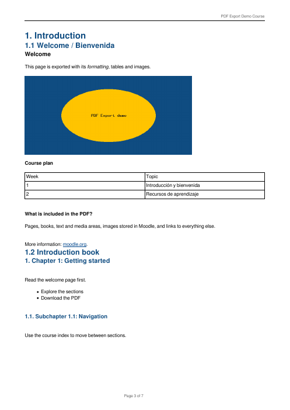
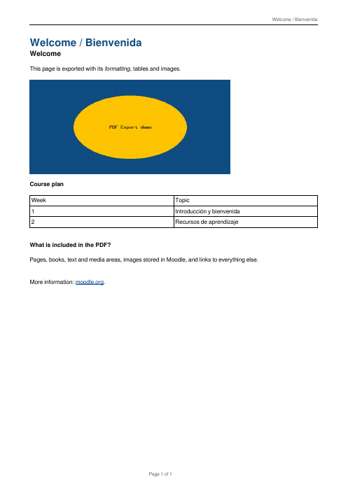

# PDF Export block for Moodle

[](https://github.com/erseco/moodle-block_pdfexport/actions/workflows/ci.yml)
[](https://codecov.io/gh/erseco/moodle-block_pdfexport)
[](https://github.com/erseco/moodle-block_pdfexport/releases)
[](https://moodle-playground.com/?blueprint-url=https://raw.githubusercontent.com/erseco/moodle-block_pdfexport/refs/heads/main/blueprint.json)

`block_pdfexport` lets teachers choose which course resources to publish, and lets
students download them as PDF: one resource at a time, or the whole selection as a
single course PDF with a cover, a table of contents and the course structure.

PDFs are generated by Moodle itself, with its bundled TCPDF library: no Chromium,
LibreOffice, Python or external conversion service is needed.

Original idea and first implementation by **[HenarLG](https://github.com/HenarLG)**.



## Features

- **Course PDF**: every published resource the user can see, in course order, grouped
  by section, with a cover (course name and summary), a clickable table of contents,
  PDF bookmarks, page numbers and a list of conversion warnings.
- **Resource PDFs**: one PDF per page, book (all chapters and subchapters), text and
  media area, file, folder or URL.
- **Per-user permissions** checked on every download: hidden activities and sections,
  availability restrictions, groups, hidden book chapters and module capabilities.
- **Safe conversion**: an allowlist of HTML tags and attributes, no JavaScript, no
  remote downloads; images only from the resource's own Moodle files.
- **Teacher configuration** grouped by section, with "Select all" per section,
  optional author attribution and content license, and an optional
  [cover style](#course-pdf-cover-style) for the course PDF.
- English and Spanish translations.

## Compatibility

| Moodle | PHP | Databases | Status |
|---|---|---|---|
| 5.3 LTS (`MOODLE_503_STABLE`) | 8.3, 8.4 | PostgreSQL 17+, MariaDB 11.4+ | Tested in CI and locally |

Other Moodle versions are not supported: `version.php` requires Moodle 5.3
(`$plugin->requires = 2026100200`, `$plugin->supported = [503, 503]`). MySQL 8.4 and
SQL Server meet Moodle 5.3's requirements but are not tested.

## Installation

1. Download `block_pdfexport-<version>.zip` from the
   [releases page](https://github.com/erseco/moodle-block_pdfexport/releases).
2. *Site administration > Plugins > Install plugins*, upload the ZIP and follow the
   upgrade screens. Or unzip it so the plugin lives in `public/blocks/pdfexport/` and
   visit *Site administration > Notifications* (or run `php admin/cli/upgrade.php`).

Nothing else is required: Moodle already ships TCPDF and the FreeSans Unicode font.

## Quick start

Try it without installing anything: the
[Moodle Playground preview](https://moodle-playground.com/?blueprint-url=https://raw.githubusercontent.com/erseco/moodle-block_pdfexport/refs/heads/main/blueprint.json)
boots Moodle 5.3 in your browser with a demo course (users `teacher_demo` and
`student_demo`, password `Demo!2026`; admin `admin` / `password`).

## Teacher guide

1. Turn editing on in the course and *Add a block > PDF Export*.
2. In the block, follow **Manage downloadable resources**.
3. Tick the resources to publish. Each one shows its type and how much of it the PDF
   reproduces (see the table below). Use **Select all** for the whole course or a
   section.
4. Optionally, under **Default authorship and license**, enter one author or
   organization per line and choose a content license: the six Creative Commons 4.0
   licenses (linked to their official deed) or a custom license with a name and an
   optional HTTP(S) link. A published resource with other authors or another license
   gets **Specific authorship and license** under its checkbox: empty authors use the
   default ones, and its license can be the default, another one or explicitly *No
   license specified*. Leave everything empty if it is not known: no license is ever
   assigned automatically.
5. Optionally, under **Course PDF cover style**, type a small stylesheet in
   **Cover CSS** (see [below](#course-pdf-cover-style)). Then **Save changes**.
6. **Download the course PDF with the saved selection** shows what students will get.
   Hidden or restricted resources you selected are only included for users who can
   see them.



Managing the selection requires `block/pdfexport:configure` and `moodle/course:update`
(editing teachers and managers by default).

## Course PDF cover style

The **Cover CSS** field, on the **Manage downloadable resources** page, styles the
cover of the course PDF. It never affects the table of contents, section headings,
resource content, bookmarks, running headers and footers, page numbers or the PDFs of
single resources. Each block has its own style. Clear the field and save to restore the
default cover.

TCPDF, the PDF engine bundled with Moodle, is not a browser: it understands only a
small part of CSS. The field therefore accepts a strict, documented subset and rejects
everything else with an error message, instead of silently ignoring it.

| Selector | Styles |
|---|---|
| `.pdfexport-cover` | Every cover element below; their own selectors override it. Its `background-color` fills the cover page. |
| `.pdfexport-cover-title` | Course full name |
| `.pdfexport-cover-subtitle` | Course short name |
| `.pdfexport-cover-attribution` | Default authors and license, when configured (links keep their colour) |
| `.pdfexport-cover-summary` | Course summary (inline styles inside the summary take precedence) |
| `.pdfexport-cover-date` | "Generated on" date |

| Property | Values |
|---|---|
| `color`, `background-color` | `#rgb` or `#rrggbb` |
| `font-size` | `6pt` to `72pt` |
| `font-weight` | `normal`, `bold` |
| `font-style` | `normal`, `italic` |
| `text-align` | `left`, `center`, `right`, `justify` |
| `line-height` | a number from `0.8` to `3` (multiple of the font size) |

Rules can list several selectors (`a, b { … }`), later declarations win, and
`/* comments */` are allowed. Example:

```css
/* Brand colours */
.pdfexport-cover { background-color: #f4f8fb; }

.pdfexport-cover-title {
    color: #123456;
    font-size: 30pt;
    text-align: center;
}

.pdfexport-cover-subtitle {
    color: #555555;
    font-size: 15pt;
}

.pdfexport-cover-date {
    color: #777777;
    font-size: 9pt;
}
```

Not supported: other selectors (`body`, `*`, element, id, descendant or pseudo-class
selectors), other properties (margins, padding, borders, positioning, flexbox, grid,
fonts, transforms, animations), named or `rgb()` colours, units other than `pt`,
`!important`, CSS variables, functions and at-rules such as `@import`, `@font-face` or
`@media`. Quotes, backslash escapes, `url()` and data URIs are rejected outright: an
export never fetches remote resources or reads files, and the stylesheet can never
inject HTML into the PDF. The stored stylesheet is validated again on every download;
an invalid one is ignored and the default cover is used. The limit is 8 KiB.

## Student guide

The block lists the published resources available to you, by section:

- **Download course PDF** downloads everything in one document.
- **Download PDF** under a resource downloads only that resource.
- SCORM and H5P activities are marked **Link only**: the course PDF describes them and
  links to them, but cannot reproduce them.



| Cover | Table of contents | Content |
|---|---|---|
|  |  |  |

A single resource PDF (here, the demo welcome page) has no cover or table of contents:



A full example generated from the demo course: [docs/screenshots/course-export.pdf](docs/screenshots/course-export.pdf).

## Supported content

| Module | In the PDF | Level |
|---|---|---|
| Page (`mod_page`) | Content, with images stored in the page | Full content |
| Book (`mod_book`) | Every visible chapter and subchapter, in book order and numbering; hidden chapters only for users who may see them | Full content |
| Text and media area (`mod_label`) | Its text and images | Full content |
| URL (`mod_url`) | Description and the address (configured URL parameters are never added) | Full content |
| File (`mod_resource`) | PNG/JPEG images embedded; other files named and linked | Partial content |
| Folder (`mod_folder`) | Description and the list of files, as links (up to 500) | Partial content |
| eXeLearning (`mod_exelearning`, optional) | Description and every package page in package order (as chapters); text iDevices printed, interactive iDevices named and omitted | Partial content |
| SCORM, H5P (`mod_scorm`, `mod_h5pactivity`) | Description, a notice and a link to the activity | Link only |
| Any other module (quiz, assignment, forum...) | Not offered for export | — |

HTML conversion keeps paragraphs, headings, lists, tables, bold and italic text,
links, PNG/JPEG images and `<details>` (expanded). Tab panes and Bootstrap collapses
are printed one after another. Elements the author hid (`hidden`, `display:none`,
`visibility:hidden`) are left out, because they can hold answers or restricted text.
Audio, video and iframes become links; scripts, forms, SVG and canvas are replaced by a
placeholder. Each of these cases adds a line to the *Conversion warnings* page.

## Security and privacy

- Every download runs `require_login()` for the course, needs
  `block/pdfexport:view`, and rebuilds the list of exportable modules from the
  downloading user's own course data. Request parameters are never trusted: the block
  must belong to the course, and a module must be published *and* available to the user.
  Hidden, unpublished, restricted and unknown modules all get the same answer, so
  nothing reveals their existence.
- Only the exported module's own file area is read. Other contexts, file areas, items
  and `..` paths are rejected. Nothing is ever downloaded from the network.
- Quizzes, assignments, forums and other activities with personal data are not
  exportable, and no attempts, grades, submissions or posts are ever included.
- The plugin stores the published module selection and the optional authorship and
  license of the content in the block configuration. Author names are free text that
  credits the content and is not linked to user accounts, so the privacy provider is a
  null provider (no user data to export or delete). PDFs are generated on request and
  are not kept.

## Authorship and license

Configured authorship and license are printed under the title of a resource PDF and on
the cover of the course PDF; in the course PDF, a resource whose authorship or license
differs from the default shows its own under its heading, with "Not specified" or "No
license specified" for missing values. The PDF *Author* metadata lists every author
and the *Subject* metadata adds every license name after the course name. The content
license is independent of the plugin's GPL license: without configuration, nothing is
printed and no license is assumed.

## Limitations

- TCPDF is not a browser: complex CSS layouts, floats and positioned elements are
  simplified. JavaScript-built content (H5P, SCORM, interactive widgets) cannot be
  printed. The cover CSS supports only the subset listed in
  [Course PDF cover style](#course-pdf-cover-style).
- PDF files published as File resources are linked, not merged into the course PDF
  (TCPDF cannot import PDF pages). An offline ZIP of original files is a possible future
  feature.
- Only PNG and JPEG images are embedded (up to 10 MB, 25 megapixels and 300 images per
  PDF). GIF, WebP and SVG images are replaced by their description.
- A course PDF holds up to 300 resources. Exports run while the user waits: 300 pages,
  each with a 1200×800 image, take about 5 seconds and 120 MB of memory.

## Development

See [DEVELOPMENT.md](DEVELOPMENT.md). In short:

```bash
make up && make demo    # Moodle 5.3 + demo course at http://localhost
make exelearning        # optional: install mod_exelearning from GitHub (then `make demo` adds an eXe activity)
make lint               # Moodle coding style
make test               # PHPUnit
make coverage           # PHPUnit with Xdebug, fails under 90% line coverage
make behat              # Behat with headless Chromium
make plugin-ci          # moodle-plugin-ci phplint/phpcs/phpdoc/validate/savepoints/mustache
make check-package      # build and check the release ZIP
```

PHPUnit line coverage of the plugin's classes (measured with Xdebug, enforced at 90%
in CI) is about 98%. Architecture: [docs/ARCHITECTURE.md](docs/ARCHITECTURE.md);
decisions: [docs/adr/](docs/adr/).

## Troubleshooting

- **"This resource is not published for download or is not available to you."** The
  resource is not selected in the block, or is hidden from you, restricted, or not
  readable with your role.
- **An image is missing from the PDF.** It is not PNG/JPEG, is too large, comes from
  another website, or is stored in another activity. The *Conversion warnings* page says
  which.
- **The local Docker site keeps redirecting.** With `MOODLE_PORT` other than 80, set
  `REVERSEPROXY=true` and include the port in `SITE_URL` in `.env`.

## Contributing

Issues and pull requests are welcome: see [CONTRIBUTING.md](CONTRIBUTING.md).

## License and credits

GNU GPL v3 or later; see [LICENSE](LICENSE).

- **HenarLG** created the plugin: the block, the resource selection, and the first
  page and book conversion with Moodle's TCPDF (versions 0.1 to 0.3.2-alpha).
- The block_pdfexport contributors completed the course export, adapters, tests,
  automation and documentation.
